# 🤖 Smart HRMS Orchestrated By AI Agents

[](https://python.org)
[](https://fastapi.tiangolo.com)
[](https://langchain-ai.github.io/langgraph/)
[](https://react.dev)
[](https://www.typescriptlang.org)
[](LICENSE)

> **Next-Generation Autonomous Human Resource Management System powered by specialized AI agents, multi-agent orchestration, and Human-in-the-Loop (HITL) safety verification.**

Developed by **Disha Sonigra** • [GitHub: @dishasonigra03](https://github.com/dishasonigra03)

---

## 💡 Overview

**Smart HRMS Orchestrated By AI Agents** transforms traditional, fragmented HR administration into an automated, coordinated intelligent workflow. Built upon **LangGraph's stateful multi-agent execution framework**, the platform delegates human resource operations—ranging from candidate sourcing and interview scheduling to payroll calculation and policy adherence—across specialized autonomous AI agents.

To ensure corporate compliance, high-risk financial and external operations (such as releasing salary disbursements or dispatching legally binding offer letters) require explicit executive sign-off through a real-time **Human-in-the-Loop (HITL)** approval gate before execution.

---

## 🌟 Core Features & Capabilities

```
┌─────────────────────────────────────────────────────────────────────────────┐
│                 SMART HRMS MULTI-AGENT PLATFORM CAPABILITIES                │
├───────────────────────┬─────────────────────────┬───────────────────────────┤
│  🤖 Multi-Agent Hub   │  🛡️ HITL Safety Gates   │  👥 Complete Talent Cycle │
│  • 7 Core HR Agents   │  • 1-Click Verification │  • Interview Scheduling   │
│  • Intent Routing     │  • Mobile Approval UI   │  • Candidate Evaluation   │
│  • LangGraph State    │  • Audit Trail Logs     │  • Automated Offer Letters│
├───────────────────────┼─────────────────────────┼───────────────────────────┤
│  💬 Multi-Channel Hub │  📊 Enterprise Insights │  🏢 Synchronized Clients  │
│  • Gmail OAuth2 MCP   │  • 9-Box Talent Grid    │  • Admin Workspace        │
│  • WhatsApp Alerts    │  • Headcount & Attrition│  • Employee Self-Service  │
│  • Real-time Sockets  │  • Bell Curve Analytics │  • CEO Mobile Interface   │
└───────────────────────┴─────────────────────────┴───────────────────────────┘
```

- **Specialized Multi-Agent Mesh**: Independent agents handle Employee Records, Attendance Tracking, Leave Policies, Deterministic Payroll, Recruitment Pipelines, Performance Appraisals, and Policy RAG (Retrieval-Augmented Generation).
- **Guaranteed Human Oversight (HITL)**: High-stakes operations pause automatically in a pending state, generating structured artifact cards that executives can inspect, edit, approve, or reject.
- **Automated 3-Phase Recruitment**:
  1. *Screening & Interview Prep*: Synthesizes job requisitions, candidate technical briefs, and Google Meet schedules.
  2. *AI Performance Scorecards*: Analyzes interview outcomes and computes competency ratings (e.g. 9.2/10) with recommendations.
  3. *Offer Letter Dispatch*: Formulates detailed compensation packages and routes through Gmail with verified OAuth2 credentials.
- **Enterprise Multi-Client Ecosystem**: Seamless experience across administrative web portals, employee self-service dashboards, and executive mobile interfaces.

---

## 🏗️ System Architecture

```mermaid
flowchart LR
    subgraph Clients["🖥️ Client Applications"]
        direction TB
        UI1["🏢 HR Admin Portal<br/>(Port 5185)"]
        UI2["👤 Employee Portal<br/>(Port 5175)"]
        UI3["📱 CEO Mobile UI<br/>(Port 5174)"]
        UI4["🌐 Careers Portal<br/>(Port 5180)"]
    end

    subgraph Gateway["⚡ API & Orchestration Gateway"]
        direction TB
        F莊["FastAPI Engine (Port 8000)"]
        LG["LangGraph State Machine"]
        F莊 <--> LG
    end

    subgraph Agents["🤖 Autonomous Agent Mesh"]
        direction TB
        AG1["Recruitment Agent"]
        AG2["Payroll Agent"]
        AG3["Leave & Attendance Agent"]
        AG4["Performance & OKR Agent"]
        AG5["Policy RAG Agent"]
    end

    subgraph Safety["🛡️ HITL & Notifications"]
        direction TB
        HITL_GATE{"Executive Approval<br/>Gate"}
        GMAIL["Gmail MCP OAuth2"]
        WA["WhatsApp Alerts"]
    end

    subgraph Storage["💾 Persistence Layer"]
        DB1[("SQLite Relational Store")]
        DB2[("MongoDB Atlas Cloud")]
        DB3[("LangGraph Checkpoints")]
    end

    Clients <==>|REST / WebSockets| Gateway
    LG ==>|Task Handoff| Agents
    Agents ==>|Sensitive Actions| HITL_GATE
    HITL_GATE ==>|Approved| GMAIL
    HITL_GATE ==>|Alerts| WA
    Gateway <--> Storage
```



---

## 📱 Service & Port Directory

| Application / Service | Location | Port / URL | Technology | Target Users |
| :--- | :--- | :--- | :--- | :--- |
| **FastAPI Core Engine** | `backend/` | `http://localhost:8000` | Python 3.11+, FastAPI, LangGraph | Backend & Swagger (`/docs`) |
| **Enterprise HRMS Admin** | `frontend/` | `http://localhost:5185` | React 19, TypeScript, Tailwind | HR Managers & Executives |
| **Employee Self-Service** | `employees/` | `http://localhost:5175` | React 19, Vite, Tailwind CSS | Employees (Check-in, Leave, Payslips) |
| **CEO Mobile Executive UI** | `ceo_mobile_chat_app/` | `http://localhost:5174` | React 19, Mobile Layout | Executive Approval & WhatsApp Bot |
| **Careers & Talent Portal** | `azyntrix/` | `http://localhost:5180` | React 19, TypeScript | Job Seekers & Talent Acquisition |
| **Talent Express API** | `azyntrix/backend/`| `http://localhost:5050` | Node.js, Express, Mongoose | Candidates & Job Requisitions |

---

## 📂 Project Structure

```text
Smart-HRMS-Orchestrated-By-AI-Agents/
├── backend/                        # FastAPI Backend & Multi-Agent Core
│   ├── agents/                     # LangGraph Agents & Orchestrators
│   │   ├── core/                   # Specialized HR Agent nodes (Payroll, Leave, etc.)
│   │   ├── orchestrator.py         # Supervisor Intent Classifier & Router
│   │   └── tools/                  # Deterministic calculation & integration tools
│   ├── api/v1/                     # REST API & WebSocket endpoints
│   │   ├── chat_api.py             # Conversational agent interface
│   │   ├── orchestration.py        # 3-Stage candidate pipeline & HITL runner
│   │   └── hr_endpoints.py         # CRUD routes for employees, leave, and payroll
│   ├── integrations/               # External adapters (Gmail OAuth2, WhatsApp)
│   ├── database/                   # Database models & SQLite engine
│   └── app.py                      # FastAPI app initialization & middleware
│
├── frontend/                       # Enterprise HRMS Admin Web Workspace (Port 5185)
├── employees/                      # Employee Self-Service Web Portal (Port 5175)
├── ceo_mobile_chat_app/            # CEO Executive Mobile Interface (Port 5174)
├── azyntrix/                       # Public Careers & Recruitment Kanban (Port 5180)
│   └── backend/                    # Node.js Talent Service (Port 5050)
├── docs/                           # Architecture guides, setup docs & reports
│   └── academic_report/            # Complete academic documentation chapters
├── .env.example                    # Environment variables template
├── run_backend.py                  # Standalone backend server launcher
├── pyproject.toml                  # Python package configuration
└── README.md                       # Main project documentation
```

---

## 🚀 Getting Started

### Prerequisites
- **Python**: Version `3.11` or above ([python.org](https://www.python.org/downloads/))
- **Node.js**: Version `20.x` or `22.x` ([nodejs.org](https://nodejs.org/))
- **Git**: Installed and configured on your system

---

### Step 1: Clone & Configure Environment

```bash
# Clone the repository
git clone https://github.com/dishasonigra03/Smart-HRMS-Orchestrated-By-AI-Agents.git
cd Smart-HRMS-Orchestrated-By-AI-Agents

# Copy the environment file template
# Windows PowerShell:
Copy-Item .env.example .env

# macOS / Linux:
cp .env.example .env
```

Open `.env` in your editor and configure your API keys (Google Gemini, Groq, or Mistral).

---

### Step 2: Start the Python Backend (Port 8000)

```bash
# 1. Create and activate a Python virtual environment
# Windows:
python -m venv .venv
.\.venv\Scripts\activate

# macOS / Linux:
python3 -m venv .venv
source .venv/bin/activate

# 2. Install dependencies
pip install fastapi uvicorn pydantic aiosqlite sqlalchemy httpx python-dotenv tenacity langchain langgraph google-auth google-auth-oauthlib google-api-python-client

# 3. Launch the server
python run_backend.py
```

- API Documentation: **[`http://localhost:8000/docs`](http://localhost:8000/docs)**
- Health Endpoint: **[`http://localhost:8000/health`](http://localhost:8000/health)**

---

### Step 3: Start Frontend Portals

Open separate terminal windows for the interfaces you wish to run:

```bash
# Terminal 1: Enterprise HRMS Admin Portal (Port 5185)
cd frontend
npm install
npm run dev -- --port 5185

# Terminal 2: Employee Self-Service Portal (Port 5175)
cd employees
npm install
npm run dev

# Terminal 3: CEO Executive Mobile Chat (Port 5174)
cd ceo_mobile_chat_app
npm install
npm run dev

# Terminal 4: Careers Portal & Talent Suite (Ports 5050 & 5180)
cd azyntrix/backend && npm install && node server.mjs
cd azyntrix && npm install && npm run dev -- --port 5180
```

---

## ⚙️ Environment Configuration Guide

Key variables available in [.env.example](.env.example):

| Variable | Required | Default / Example | Purpose |
| :--- | :---: | :--- | :--- |
| `GEMINI_API_KEY` | **Yes** | `AIzaSy...` | Primary reasoning and evaluation engine via Google AI Studio |
| `GROQ_API_KEY` | Optional | `gsk_...` | High-speed LLM inference for conversational chat routing |
| `MISTRAL_API_KEY` | Optional | `qHVK...` | Secondary LLM provider fallback |
| `DATABASE_URL` | **Yes** | `sqlite+aiosqlite:///./hrms.db` | Async relational database connection string |
| `GMAIL_CLIENT_ID` | Optional | `...apps.googleusercontent.com` | Google Cloud OAuth2 Client ID for automated email sending |
| `GMAIL_SENDER_EMAIL`| Optional | `your-email@gmail.com` | Authorized sender email address |
| `GMAIL_TEST_RECIPIENT`| Optional | `dishasonigra95@gmail.com` | Test recipient for candidate onboarding emails |
| `CEO_PHONE_NUMBER` | Optional | `+919876543210` | Destination phone for WhatsApp executive notifications |

---

## 🔒 Security & Governance

- **Zero-Trust Access Control**: Granular RBAC differentiating between Admin, HR Executive, Employee, and Candidate roles.
- **Fail-Safe HITL Verification**: Financial disbursements and external communications are blocked from executing autonomously.
- **State Auditing**: Complete audit logs tracing user intent, agent decisions, tool execution parameters, and status changes.
- **Token Security**: Cryptographically signed stateless JWT authentication with automated expiry mechanisms.

---

## 📄 License & Attribution

Distributed under the **[MIT License](LICENSE)**.

```
Copyright (c) 2026 Disha Sonigra & Smart HRMS Team
```

Crafted with dedication by **[Disha Sonigra](https://github.com/dishasonigra03)** • **Smart HRMS Orchestrated By AI Agents 2026**
